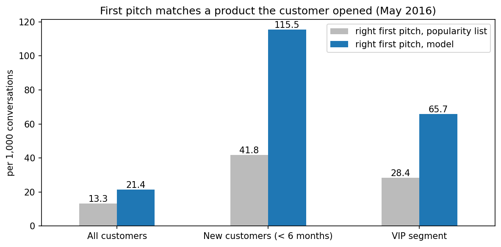
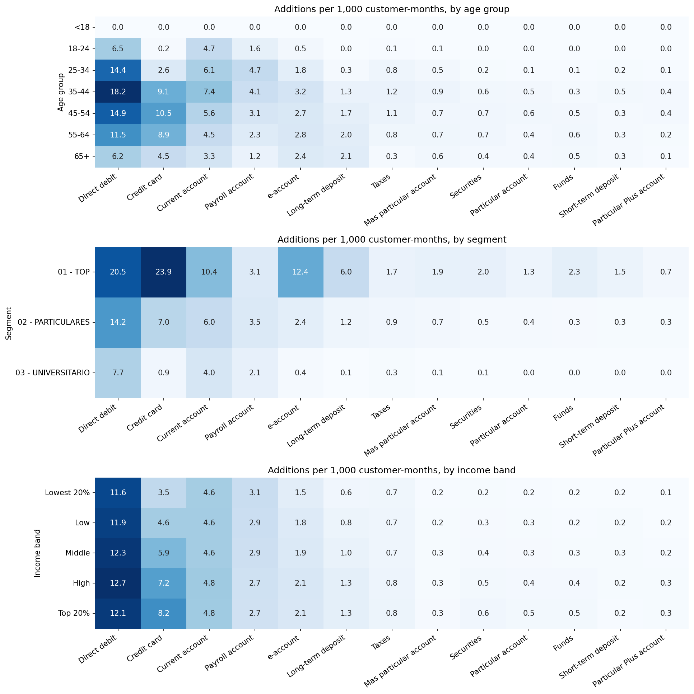
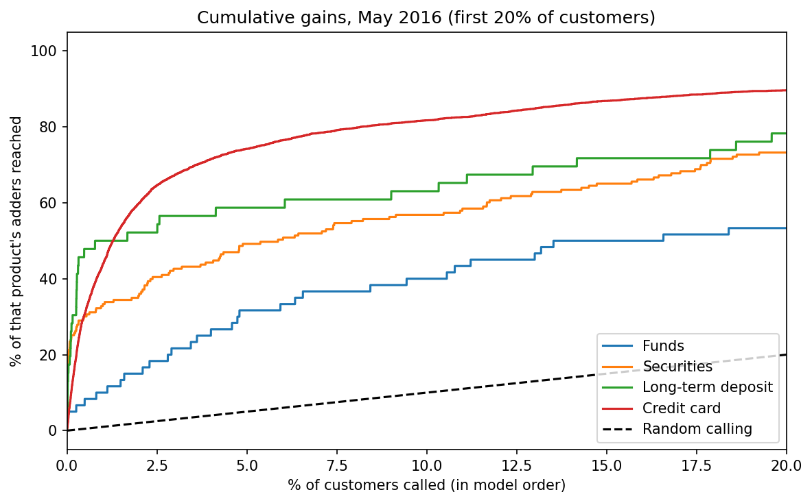

# Bank Product Recommender

**A model that tells a bank's relationship managers which product to pitch next, to each customer.**

Built as a portfolio project on public data from Santander's [Product Recommendation competition](https://www.kaggle.com/c/santander-product-recommendation) on Kaggle: real, anonymized records of about 950,000 bank customers in Spain, January 2015 to May 2016. The whole project follows the CRISP-DM cycle in one notebook: [`bank_product_recommender.ipynb`](bank_product_recommender.ipynb).

## The problem

Banks earn more from customers who hold several products, and selling one more product to an existing customer (cross-selling) is cheaper than finding a new one. But a relationship manager (RM) can't pitch 24 products to everyone.

The goal: a monthly call list where each customer gets a ranked list of products they don't have yet. The RM pitches the top 3.

## Results

Tested on May 2016, a month kept locked until the very end:

| | Popularity list (baseline) | Model |
|---|---|---|
| MAP@7, as a share of the best possible score | 64% | **89%** |
| RM's first pitch matches a product the customer opened | 52% | **84%** |
| Right first pitches per 1,000 conversations, all customers | 13.3 | **21.4** (+61%) |
| Right first pitches per 1,000 conversations, new customers | 41.8 | **115.5** (almost 3x) |

The baseline recommends the most popular products to everyone. The model beats it most for customers who are least like the average customer: new customers, VIPs, and older customers.

## What the data showed

**Who adds what depends on who they are.** VIP customers add credit cards about 26 times as often as students. Credit card sign-ups rise with income, while direct debit stays flat, because everyone pays bills but credit depends on earnings.

**The model is weakest where an RM matters most.** It is excellent at everyday products customers open on their own (direct debit, current accounts) and weak at investment products (funds, securities), which are rare and harder to predict. Flipping the list helps: instead of "best product for this customer," rank "best customers for this product." Calling the model's top 1% for funds reaches customers 10 times as likely to open one, and the top 10% reaches 40% of everyone who did.

## Approach

| CRISP-DM phase | Key decisions |
|---|---|
| **1. Business Understanding** | RM call list, top 3 pitches. MAP@7 as the main metric (the Kaggle metric), hit rate as the business metric. A popularity baseline to beat. |
| **2. Data Understanding** | 13.6M rows. Found 27,734 rows with a blank profile, a `-999999` placeholder in tenure, and ages from 2 to 164. Only 3.5% of customer-months add any product. Two employer-driven products (payroll, payroll pension) excluded from the RM list. |
| **3. Data Preparation** | Missing income filled with the median of similar customers (same province and segment), with a minimum of 30 customers per group after one group's median turned out to come from a single person. Target built as "products added this month." 143 features, including 5 months of product history. |
| **4. Modeling** | LightGBM multiclass model. Tested 12 setups (training months × history length × engineered features) on a validation month, then re-ran the top 3 with different random seeds to make sure the winner wasn't luck. |
| **5. Evaluation** | Per-product and per-customer-group results, a product-first campaign view, and a translation into "right first pitches per 1,000 RM conversations." |
| **6. Deployment** | Sample RM call lists, a funds campaign list, and a `recommend(customer_id)` function. |

## What this model can't prove

The data has no campaign history, so the model learned what customers open **on their own**, not what an RM's pitch **causes** them to open. If it recommends a product the customer was going to open anyway, that isn't an extra sale.

**Recommendation: run a pilot before any rollout.**

- **Who:** new customers (joined less than 6 months ago), where the model helps most.
- **How:** randomly split RMs. Half use the list, half work as usual, for 3 months.
- **Measure:** pitchable products opened per customer, plus products closed again within 3 months (to catch customers pushed into things they don't want).
- **Size:** about 9,900 customers per group to reliably detect a 10% improvement. The current pool of new customers is big enough.

Other limitations: the model trains on the 4 most recent months, so it never saw last year's tax season (taxes were its weakest product), and patterns from Spain in 2015 to 2016 would need retraining for another market.

## How to run it

1. Download `train_ver2.csv.zip` from the [competition's data page](https://www.kaggle.com/c/santander-product-recommendation/data) (you need to accept the competition rules first) and unzip it into a `data/` folder.
2. Install the packages: `pip install -r requirements.txt`
3. Open the notebook and run all cells. The first run reads the 2.3 GB CSV (about 2 minutes) and saves a faster Parquet copy. The experiments in section 4.3 and 4.4 take about 13 minutes. A machine with 16 GB of RAM or more is recommended.

The data itself is not included in this repository, in line with the Kaggle competition rules.
